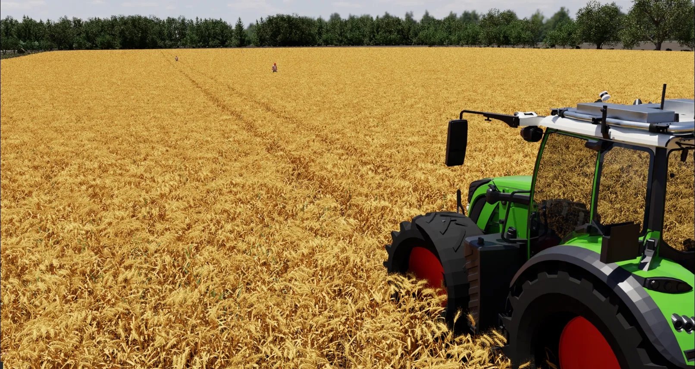
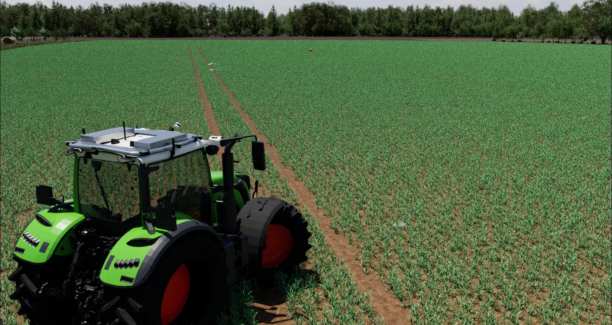
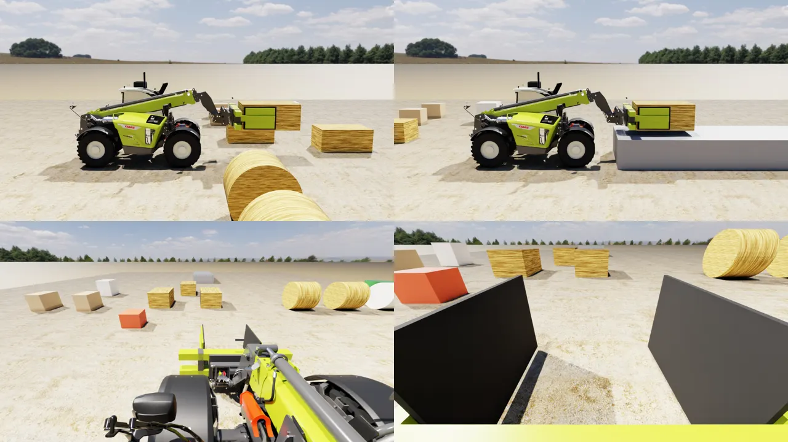

# farm_sim

Virtual farm for testing the Smart Farming Lab perception pipelines in Isaac Sim 6.1, with the
Fendt 724 Vario + sensor rig from [`vario700_sensorrig`](../vario700_sensorrig) and the camera
calibration from [`tractor_multi_cam_publisher`](../tractor_multi_cam_publisher). Lives in the
workspace's `src/` next to them, with a `COLCON_IGNORE` (it runs in Isaac's Python, not colcon).

- **Phase 1:** the tractor as a PhysX vehicle you can drive with WASD, the full sensor rig simulated with
  the real calibration, everything on ROS 2 with the real rig's topic names.
- **Phase 2:** a procedural German wheat field (one YAML, one seed) and a scenario system with animated
  people, animals, vehicles and obstacles.
- **Telehandler:** a second simulation for telehandler automation: Claas Scorpion 1033 (from the FS25 mod,
  as a URDF in [`scorpion1033_description`](../scorpion1033_description)) with a bale clamp, two ZED X and
  two Ouster OS1-128, in a yard with bales and crates to pick up. See [Telehandler](#telehandler-claas-scorpion-1033).

| Ripe wheat (July), people in the tramline | Young wheat (April), deer in the field |
|---|---|
|  |  |

## Quick start

```bash
cd ~/ros2_ws/src/farm_sim
STICK=/run/media/$USER/46E7-B98B/Simulation tools/build_assets.sh   # once: wheat, actors, Poly Haven CC0
source scripts/isaac_env.sh          # Isaac venv + its bundled ROS 2 Jazzy libs (never source /opt/ros here)
python scripts/run_sim.py --scenario config/scenarios/wheat_demo.yaml   # GUI; click the viewport, then drive
python scripts/run_sim.py            # the small phase-1 test field (starts in seconds)
```

In a second terminal (host ROS 2 Lyrical):

```bash
source /opt/ros/lyrical/setup.bash
export FASTDDS_DEFAULT_PROFILES_FILE=~/ros2_ws/src/farm_sim/config/fastdds_large_msgs.xml
~/ros2_ws/src/farm_sim/scripts/rig_tf.sh             # base_link -> sensor TF from the same URDF, sim time
python3 ~/ros2_ws/src/farm_sim/tests/check_topics.py # rates, frames, sample images in out/topics/
```

Run your perception nodes with `use_sim_time:=true`.

| Keys (viewport focused) | |
|---|---|
| W / S | raise / lower the speed setpoint; releasing holds the speed (Vario joystick). Through zero it stops; press S again to reverse |
| A / D | steer (rate-limited, faster below 18 km/h like VarioActive; self-centres with speed) |
| SPACE | brake to a stop (5 m/s²) |
| C | centre steering |
| V | cycle view: chase, cab, side, free camera |
| T | show / hide the tractor for cameras (hidden by default so the sensor cameras see clear ground; RTX can't do per-camera visibility, so it also disappears from the viewport, its shadow stays) |
| R | reset |
| H | print keys |

Other modes:

```bash
python scripts/run_sim.py --stream              # headless + WebRTC; connect with NVIDIA's "Isaac Sim WebRTC
                                                # Streaming Client" to this machine (port 49100). Keyboard works there too.
python scripts/run_sim.py --headless --no-viewport   # sensors + ROS only
python scripts/run_sim.py --headless --no-sensors --no-ros --drive-test out/drive_test.csv
python scripts/run_sim.py --calibration kalibr --rebuild-robot   # other extrinsics set
python scripts/run_sim.py --gpu-physics          # PhysX GPU dynamics instead of the CPU solver (slower here)
python scripts/run_sim.py --field config/fields/wheat_ripe_de.yaml  # field without actors
python scripts/run_sim.py --headless --no-sensors --no-ros --scenario config/scenarios/wheat_demo.yaml \
    --autodrive 7 --duration 62 --record out/rec --record-view chase     # demo video frames
python3 tools/make_video.py out/rec out/demo.mp4                        # H.264 (host python)
python scripts/run_sim.py --headless --no-sensors --no-ros --scenario config/scenarios/wheat_demo.yaml \
    --field config/fields/wheat_ripe_de.yaml --autodrive 7 --cinematic config/cinematic/flyaround.yaml \
    --record out/cine --record-view cinematic --record-fps 25 --render-hz 25 --record-start 4 --duration 25.1
```

`--cinematic YAML` adds a keyframed camera (`farm_sim/cinematic.py`) that flies around the moving
tractor: keyframes in the tractor frame (position, look-at point, focal length), Catmull-Rom
interpolated, heading/height low-pass filtered so the shot doesn't shake. It is the first view (V)
and recordable as `--record-view cinematic`; `config/cinematic/flyaround.yaml` is a 20 s move (low
in the wheat ahead, sweep along the side, crane up behind to a field reveal). `--record-start`
skips the frames before the move starts.

`--autodrive KMH` cruises and keeps to the tramline it started on (proportional lane keeping).

The WebRTC signalling port listens on all interfaces, so anyone on the network can connect and drive.
Firewall it if that matters.

## Phase 2: the field

`config/fields/wheat_ripe_de.yaml` describes the whole scene; `farm_sim/field/` builds it in ~5 s:

- **Terrain:** rolling fractal relief (±4 m over ~450 m) plus micro-relief, a 1 m mesh over 900 m and a
  coarse ring to 6 km, a 2 m triangle-mesh collider for the vehicle.
- **Crop:** ~1 M ripe winter wheat clumps (your Turbosquid pack, 8 ripe variants, 1.35-1.6x scaled to
  0.8-1.0 m) on 25 cm rows; end headlands sown crosswise; 24 m tramlines whose wheel tracks match the
  Fendt's 1.86 m track; gaps, lodged patches, thinner border, soil-driven height patches, wind lean,
  3 % green late tillers.
- **Around it:** Feldrain with tall grass and flowers, gravel farm track with a grass centre strip,
  hedgerow (oak, beech, ash, hawthorn, elder, privet, viburnum), apple/ash tree row along the track,
  spruce/beech forest edge with a hunting stand, wooden 3-wire power line, six wind turbines with
  turning rotors, neighbouring parcels (stubble, meadow, soil, wheat, rapeseed, maize) to the horizon.
- **Sky:** Poly Haven HDRI (`kloppenheim_05`, Hesse; nine others downloaded, set `sky.hdri`).
- **Growth stages:** `wheat_ripe_de.yaml` (July, 0.8-1.0 m), `wheat_green_de.yaml` (late May, green
  heading, ~0.75 m), `wheat_young_de.yaml` (April, ~0.3 m, open soil between rows). The latter two
  `extends:` the ripe field, so layout and surroundings stay identical and only the crop changes.

Everything carries a semantic class (`crop`, `grass`, `tree`, `shrub`, `ground`, `person`, `deer`, ...).

## Phase 2: scenarios and actors

`config/scenarios/*.yaml` lists actors in field coordinates; `config/actors.yaml` is the catalog.

| type | how it moves |
|---|---|
| `person` | Isaac characters on `omni.anim.behavior` (motion-matched walking). `behavior: walk` (path, loop), `cross` (steps into the tramline when the tractor is within `trigger_m`), `idle` (`face: robot` looks at the tractor), `lying` (static pose, on back/side). Walkers with `yield_m` step `yield_side_m` (2.5 m) aside when the tractor comes closer, watch it pass and walk on |
| `deer`, `cow` | placeholders from the stick (static / stiff) until the Fab animals arrive |
| `tractor_trailer` | New Holland T7 + trailer, kinematic along a path (e.g. the farm track) |
| `round_bale`, `bales`, `boulder`, `stump` | static obstacles |

`wheat_demo.yaml`: someone walking down the tramline towards the tractor, someone stepping into it at
25 m, a person lying half hidden in the crop next to the tramline, a spectator at the margin, a walker on
the farm track, two deer, traffic on the track, bales on the headland, a field stone.

Measured (RTX PRO 6000, field + scenario + 7 cameras + lidar + ROS + GT boxes): 0.88x real time with
the default `--render-hz 30` (physics 60 Hz, two substeps per rendered frame), 0.56x with
`--render-hz 60`; 0.98x without people (their navmesh queries cost ~10 %). Cameras 15 Hz and lidar
10 Hz stay exact in sim time; IMUs and odometry publish once per rendered frame (30 Hz).
Those numbers predate the switch to the CPU physics solver, which is faster again: in paired runs
(same command, alternating, machine shared with other GPU work) it beat `--gpu-physics` every time,
0.61x vs 0.41x with sensors and 1.32x/1.44x vs 0.69x/1.05x unpaced with `--no-sensors`.

## Ground truth (sim only)

Replicator's segmentation/box outputs (the `SemanticSegmentation`, `InstanceSegmentation`, bbox render
vars behind Isaac's ROS camera helper) are unusable in the full field: the GPU part is cheap, but their
per-frame id -> label mapping walks all ~1.5 M plant instances on the CPU (at 60 Hz render: 0.61x real
time without, semantic seg 0.28x, instance seg 0.05x, 3D boxes ~0; at 30 Hz: 0.88x -> 0.33x with
semantic seg, the same with the vegetation left unlabelled). So object ground truth is computed from
the scenario itself (`farm_sim/ground_truth.py`, ~0.05x cost):

| Topic | Type | Content |
|---|---|---|
| `/gt/objects` | `vision_msgs/Detection3DArray` (`base_link`) | oriented 3D box of every actor within `max_range_m`; `id` = actor name, `class_id` = class |
| `/gt/<camera>/detections_2d` | `vision_msgs/Detection2DArray` (optical frame) | projected box of every actor in view (pinhole or Kannala-Brandt); `score` = visible fraction of the box (depth test: anything closer than the object's near face occludes) |

Cameras are chosen with `sensors.ground_truth.cameras` (default `zed_left`). The host needs
`sudo apt install ros-lyrical-vision-msgs` to decode them. Optional Replicator images
(`ground_truth.images`: depth is free; segmentation/boxes only in the small test field) and lidar
per-point object ids (`lidar_object_ids`: adds `object_id` (128-bit, 4x uint32) to `/ouster/points`
and `/ouster/object_id_map` (JSON, low 32 bits -> prim path) but needs renderer stable ids, ~10x frame
time with the wheat) are off by default. For lidar evaluation, labelling points by the `/gt/objects`
boxes is the cheap way.

## What is simulated

| Real sensor | Sim | Topic (frame) | Rate |
|---|---|---|---|
| Ouster OS0-128 rev7 | RTX lidar `OS0_REV7_128ch10hz512res`, full sweeps, x/y/z/intensity/timestamp/channel_id | `/ouster/points` (`os_lidar`) | 10 Hz |
| Ouster IMU | physics IMU | `/ouster/imu` (`os_imu`) | per frame (30 Hz) |
| 5× ArkCam | RTX camera, Kannala-Brandt, calibration from `tractor_multi_cam_publisher/calibration/<set>/camera_<label>.intrinsics.yaml`, `camera_info` = `equidistant` with the file's K/D | `/camera/<label>/image_raw`, `/camera/<label>/image_raw/camera_info` (`camera_<label>`) | 15 Hz |
| ZED 2i | raw left/right, `opencvPinhole` with the MSA `rational_polynomial` calibration, 1104x621 | `/zed/zed_node/{left,right}_raw/image_raw_color`, `.../{left,right}_raw/camera_info` (`zed_{left,right}_camera_optical_frame`) | 15 Hz |
| ZED IMU | physics IMU | `/zed/zed_node/imu/data` (`zed_imu_link`) | per frame (30 Hz) |
| — | odometry + TF | `/odom`, `/tf` (`odom -> base_link`), `/clock` | per frame (30 Hz) |

The calibration set defaults to `robot.calibration` (`msa_new`), so intrinsics and extrinsics come from
the same calibration run (`sensors.camera_calibration` in the config). The ArkCams are mounted on the
calibrated `camera_<label>` links, which already are optical frames (z forward, y down); the URDF's
extra `camera_<label>_optical_frame` rotation on top of them points the camera sideways. The real
driver stamps `camera_<label>_optical_frame`, so for TF on real data that joint should become identity.
Real driver images are JPEG (`.../image_raw/compressed`); the sim publishes raw, republish with
`image_transport republish raw compressed` if a node only takes compressed.

All extrinsics come from `urdf/vario700_sensorrig_<calibration>.urdf` (default `msa_new`).
`zed_imu_link` is not in the calibration URDFs yet and is grafted from the base URDF
(`scripts/make_rig_urdf.py` writes the merged URDF that `rig_tf.sh` uses).

### Vehicle model (Fendt 724 Vario)

PhysX vehicle with raycast wheels, Ackermann steering (52° inner lock, wheelbase 2.782 m from the
URDF), permanent 4WD (40/60 torque split), 8.6 t, front axle suspension. On top of it,
`farm_sim/vario_drive.py` models the Vario CVT: closed-loop ground-speed control within the
traction limit (62 kN) and engine power (174 kW), active standstill, shuttle through zero.
All parameters are in `config/vario724.yaml`; values marked "estimate" there are spec-sheet
numbers or guesses, not measurements.

Scripted manoeuvre results (`--drive-test`): rest height of `base_link` 0.258 m (URDF: 0.258 m),
cruise 21.5 ± 0.7 km/h at a 21.6 km/h setpoint, full-lock circle 3.34 m `base_link` radius at 7.3 km/h
(Ackermann geometry: 3.27 m), SPACE stops from 7.4 km/h in 0.57 s / 0.45 m, reverse holds its setpoint.
CPU and GPU solver agree to 4 cm over the whole 52 s run; each is deterministic run to run.

## Telehandler (Claas Scorpion 1033)



```bash
cd ~/ros2_ws/src/farm_sim
python3 tools/build_scorpion1033_description.py   # once (and after editing the description part of the config)
source scripts/isaac_env.sh
python scripts/run_telehandler.py                  # GUI; click the viewport, then drive (H: keys)
python scripts/run_telehandler.py --headless --no-viewport   # sensors + ROS only
```

On the host (TF for all links from the URDF; build the package once):

```bash
source /opt/ros/lyrical/setup.bash
cd ~/ros2_ws && colcon build --packages-select scorpion1033_description --cmake-args -DPython3_EXECUTABLE=/usr/bin/python3
source install/setup.bash
export FASTDDS_DEFAULT_PROFILES_FILE=~/ros2_ws/src/farm_sim/config/fastdds_large_msgs.xml
ros2 launch scorpion1033_description description.launch.py      # robot_state_publisher, sim time
python3 src/farm_sim/tests/check_telehandler_topics.py --command  # rates, frames, images, ROS control
```

| Keys (viewport focused) | |
|---|---|
| W / S | drive forward / reverse while held (hydrostatic: release and it slows to a stop); SPACE brakes |
| A / D | steer (stays where it is), C centres, M cycles the steering mode: front, all-wheel, crab |
| UP / DOWN | boom up / down (0-60 deg, 15 deg/s) |
| RIGHT / LEFT | telescope out / in (two stages, 0-6 m, 0.4 m/s each) |
| Q / E | carriage tilt back / forward (levelled against the boom like the real compensation cylinder; L toggles) |
| X / Z | clamp open / close (0.6-2.1 m, force-limited) |
| V | view: chase, cab, side, tool (follows the carriage), free camera |
| R / H | reset / print keys |

**Model.** `tools/build_scorpion1033_description.py` decrypts the mod's `.i3d.shapes` (FS25 is file version
10; `farm_sim/i3d.py`), splits its merged mesh by bone into URDF links and writes the
`scorpion1033_description` package: chassis, pendulum rear axle (±8°), four steered knuckles (±35°),
wheels (460/70 R24, generated: the mod loads its tyres from the game), boom lift (0-60°), two telescope
stages, carriage tilt, the three hydraulic cylinders (lift, compensation, tilt) and the bale clamp
(two prismatic arms with rubber pads; the mod only has the quick hitch). Collision hulls are the mod's own.
Paint colours come from the mod's materials, CLAAS decals from its textures. In Isaac it becomes one
PhysX articulation (`farm_sim/telehandler/builder.py`): wheels are velocity-driven per wheel (Ackermann
angle and path speed for each steering mode), the hydraulics are rate-limited position drives with the
mod's speeds, the clamp is force-limited (12 kN per arm), and the cylinders follow the boom kinematically
(they are closed loops, which URDF cannot express; their joint values are computed and published).
Objects are held by friction only. Everything is in `config/scorpion1033.yaml`; masses are the mod's
7.4 t split by estimate.

**Scene.** `config/scenes/bale_yard.yaml`: gravel pad, straw and silage round bales, big square bales,
pallet crates, an IBC, a block and a 1 m platform to stack on (all dynamic rigid bodies with mass and
friction, semantic classes `bale`, `pallet_box`, `block`). `config/scenes/empty.yaml` for driving tests.

| Topic | Type | Frame | Rate |
|---|---|---|---|
| `/zed_front/zed_node/{left,right}/image_rect_color`, `.../camera_info` | Image (960x600 rgb8), CameraInfo | `zed_front_{left,right}_camera_optical_frame` | 15 Hz |
| `/zed_front/zed_node/depth/depth_registered` | Image 32FC1 [m], registered to left | `zed_front_left_camera_optical_frame` | 15 Hz |
| `/zed_front/zed_node/imu/data` | Imu | `zed_front_imu_link` | per frame (30 Hz) |
| `/zed_tool/zed_node/...` | same for the ZED X above the clamp | `zed_tool_*` | |
| `/ouster_cab/points`, `/ouster_rear/points` | PointCloud2 x/y/z/intensity/timestamp/channel_id, full sweeps | `ouster_{cab,rear}_os_lidar` | 10 Hz |
| `/ouster_cab/imu`, `/ouster_rear/imu` | Imu | `ouster_{cab,rear}_os_imu` | per frame |
| `/joint_states` | JointState, all 21 joints (incl. cylinders) | | per frame |
| `/odom`, `/tf` (`odom -> base_link`), `/clock` | | | per frame |
| `/telehandler/state` | JointState: boom_lift [rad], telescope [m], tool_tilt [rad, levelled], clamp [m], speed, steer | | per frame |

Commands: `/cmd_vel` (Twist: linear.x m/s, angular.z rad/s, converted with the current steering mode;
stops 0.5 s after the last message), `/telehandler/implement_cmd` (JointState with any of `boom_lift`,
`telescope`, `tool_tilt`, `clamp`: `position` = target, `velocity` = rate), `/telehandler/steering_mode`
(String `front | all_wheel | crab`). Keyboard and ROS can be mixed; a key cancels a ROS position goal.

Sensor mounts (`description.zed` / `description.ouster` in the config): `zed_front` on the front edge of
the cab roof, 25° down (sees the clamp past the boom); `zed_tool` on the carriage above the clamp, 30° down
between the pads (moves with boom and tilt); `ouster_cab` on the cab roof behind the beacon mast;
`ouster_rear` on the counterweight. ZED images are pinhole-rectified at the ZED wrapper's default
published size (HD1200 downscaled by 2); the right `camera_info` carries the 120 mm baseline in P.
`os_lidar` is yawed 180° from `os_sensor` like the Ouster driver's frames; the sim checks the asset's beam
origin against the URDF at startup.

**Tests** (headless, `--no-ros --no-sensors`, ~8x real time):

| Script | Result |
|---|---|
| `tests/telehandler_pick_place.yaml` | drive 5.6 m (5.61 m driven, 1 cm lateral drift), clamp the 450 kg square bale, lift, carry 11.5 m at 9 km/h, set it on the 1 m platform: 3/3 checks |
| `tests/telehandler_round_bale.yaml` | crab to the round bale, grip it by the flat ends, lift to 3.2 m and roll back 20°, set down: 2/2 |
| `tests/telehandler_reach.yaml` | 60°, 6 m: carriage pivot at 9.9 m (mod: 10 m lift height), tilt limits, back on the wheels: 3/3 |
| `tests/telehandler_steering.yaml` (`--log`) | 20° at 2 m/s: front R 8.07 m (geometry 7.94), all-wheel 3.96 m (3.91), crab 20.0° course at zero yaw rate |

Speed: physics 120 Hz on the CPU solver, render 30 Hz. All sensors + ROS: ~0.75x real time (full HD1200
ZED: ~0.6x; the four ZED images through ROS are the main cost, rendering alone runs 1.6x); without
sensors ~8x.

## Layout

```
config/vario724.yaml          vehicle, sensors, topics (edit this, not the code)
config/fastdds_large_msgs.xml bigger UDP buffers so clouds/images survive Jazzy <-> Lyrical
farm_sim/urdf_rig.py          URDF reader (fixed-joint tree -> poses in base_link)
farm_sim/obj_usd.py           OBJ/MTL -> USD (Kit's converter is broken on Ubuntu 26.04, see below)
farm_sim/robot_builder.py     URDF + config -> assets/robot/vario724.usd (PhysX vehicle, frames, views)
farm_sim/world.py             physics scene, ground, sky, test field
farm_sim/sensors.py           RTX lidar/cameras + IMUs on the URDF frames
farm_sim/ros_bridge.py        ROS 2 graphs
farm_sim/vario_drive.py       keyboard -> Vario CVT/steering model -> PhysX controller
farm_sim/cinematic.py         keyframed fly-around camera for recordings (config/cinematic/*.yaml)
scripts/run_sim.py            entry point
scripts/rig_tf.sh             robot_state_publisher for the rig TF (host side)
tests/check_topics.py         host-side check of every topic

config/scorpion1033.yaml      telehandler: description (mod, clamp, sensor mounts), drives, sensors, topics
config/scenes/*.yaml          telehandler yards (objects to pick up)
farm_sim/i3d.py               GIANTS i3d/.i3d.shapes reader (FS19-FS25: cipher, shapes, scene graph, skinning)
tools/build_scorpion1033_description.py  FS25 mod -> scorpion1033_description (URDF, meshes, textures)
farm_sim/urdf_model.py        URDF reader with moving joints and primitives
farm_sim/telehandler/builder.py  URDF -> PhysX articulation USD (assets/robot/scorpion1033.usd)
farm_sim/telehandler/control.py  keyboard + ROS -> wheels, steering modes, hydraulics, clamp, cylinders
farm_sim/telehandler/rig.py   ZED X / Ouster OS1 / IMUs + ROS graphs
farm_sim/telehandler/yard.py  scene: ground, sky, bales, crates, platform
farm_sim/telehandler/script.py   step scripts for headless tests (tests/telehandler_*.yaml)
scripts/run_telehandler.py    entry point
tests/check_telehandler_topics.py  host-side check of every topic + ROS control
```

## Environment notes

- **ROS 2 Lyrical is not supported by Isaac Sim 6.1**, which ships Humble/Jazzy libs only. The sim runs on
  its bundled Jazzy libs and talks to Lyrical over DDS (Fast DDS on both sides). Verified for all topics
  above. The two Fast DDS versions cannot use shared memory, so everything goes over UDP loopback;
  without `fastdds_large_msgs.xml` on both sides about 30 % of point clouds were dropped.
- `libxml2.so.2` is missing on Ubuntu 26.04, so Kit's asset converter/importer extensions fail to load
  (harmless tracebacks at startup). We convert meshes ourselves.
- Extensions must be enabled at launch (`extra_args`), not at runtime: enabling `omni.physx.vehicle`
  on a running app sporadically segfaulted in `omni.graph.image.core`.
- Viewport capture returns black frames in headless mode; `farm_sim/capture.py` uses a Replicator
  annotator instead.
- NVIDIA vegetation assets are authored in centimetres; `world._reference` rescales by `metersPerUnit`.
- RTX's `opencvFisheye` lens model crops the image to a circle of radius W/2. The ArkCams use
  `kannalaBrandtK3`, which is the same model and fills the frame.
- The CPU governor is on `powersave` (Kit warns about it). `performance` gives more headroom.
- Isaac enables GPU dynamics by default. For one articulation and a few bodies its launch overhead costs
  ~4.5 ms per physics step; the CPU solver needs 0.34 ms. `world.setup_physics` therefore selects the
  CPU solver (+ MBP broadphase) for both sims. The Vario (raycast wheels on the terrain mesh) is faster on it too and drives the same
  (`run_sim.py --gpu-physics` to compare).
- FS `.i3d.shapes` are obfuscated with a seed-indexed stream cipher (same since FS19). File version 10
  (FS25) adds one uint32 after the shape options and a uint16 per subset; merged meshes store each
  part's vertices in its bone's frame (single blend index), which is what lets the mesh split into links.

## Phase 2 environment notes (things that cost time to find)

- Right after loading, the million-instance PointInstancers get re-synced every frame (CPU-bound, 6 fps,
  GPU idle). Hiding and re-showing them once fixes it (`FieldScene.refresh_render`, 6 -> 60 fps).
- Behavior agents re-plan their *whole* path every frame: a 100 m `move_along` costs ~50 ms/frame per
  person. Walks are fed as ~12 m `move_to` legs, and a new leg is only issued when the last one is done.
  Targets must be on the navmesh (just below the terrain); terrain-height targets are rejected (-1).
- The behavior system disables itself without a navmesh. Baking against the full scene is refused, so
  it is baked on a dedicated walk surface around where people are, with the field excluded.
- The motion library has no fall/crouch motion (`fall()` returns -1) and agents own their root
  transform, so lying people are non-agent characters with a static pose captured from an idle agent
  (`assets/poses/stand_relaxed.json`).
- Poly Haven plant USDs carry a MaterialX network that RTX renders untextured; they get preview-surface
  overrides. `grass_bermuda_01` (no alpha map) and dandelion/weed/sorrel render black and are left out.
- NVIDIA's `Sycamore` tree is autumn-coloured; not used in July scenes.
- RTX fog also fogs the sky dome, so haze is only useful with misty HDRIs.

## Known limitations / next steps

- Crouching/kneeling needs extra clips (behavior custom actions, e.g. from Mixamo/Fab).
- Animals are placeholders; replace them via `config/actors.yaml` once the Fab/Quixel assets are in
  (convert with `tools/blender/convert_asset.py`, `--keep-anim` for rigged ones).
- Digital-twin terrain of the real test field (GeoSN DGM1/DOP20) is still open: needs the location.
- The tractor/rig visual meshes do not match the real mounting relative to the calibrated camera poses
  (cameras sit at z = 3.0 m, on top of the rig mesh): visible, they block parts of rear_mid/rear_left
  and the side cameras that the real cameras see clearly. They are therefore hidden from all cameras
  (`sensors.hide_vehicle_from_cameras`, `primvars:hideForCamera`, shadows kept; T toggles).
- The FS22 cab interior is opaque, so the "cab" view sits just ahead of the windscreen.
- IMUs publish once per rendered frame (30 Hz; `--render-hz 60` for 60 Hz), not 100/200 Hz.
- 2D ground-truth boxes are projected 3D boxes (people: 0.6 x 0.4 m x agent height), not pixel-tight
  masks; the visibility score is a depth-test estimate.
- Telehandler: the clamp is a generic design (the mod has none); the tyres are generated (the mod uses the
  game's shared wheels, as for lights, hoses and decals from the game's data, which are left out). Wheels
  are rigid cylinders (no tyre deflection or slip model beyond Coulomb friction), there is no engine or
  hydraulic flow model (rates are fixed), and masses/inertias are estimates. The ZED depth is perfect
  rendered depth to ~500 m (the real camera is noisy and limited to ~20 m); no ZED point cloud topic yet.
